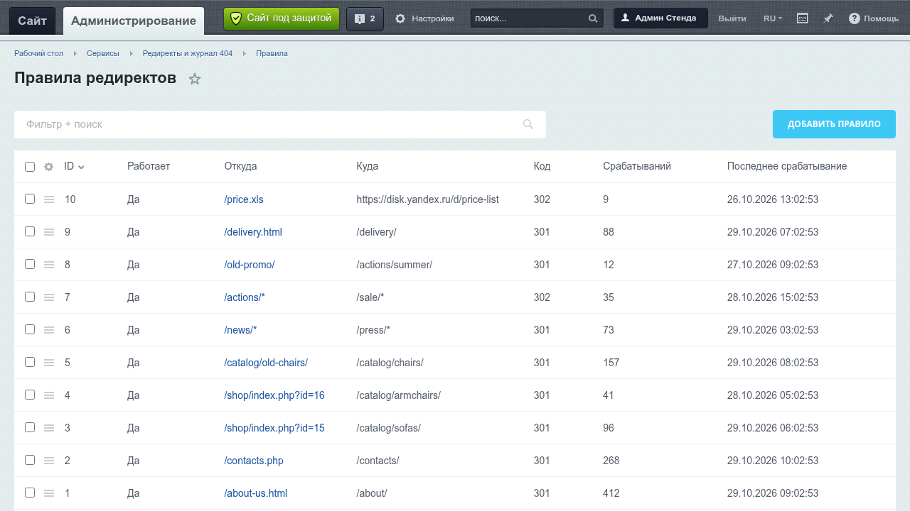
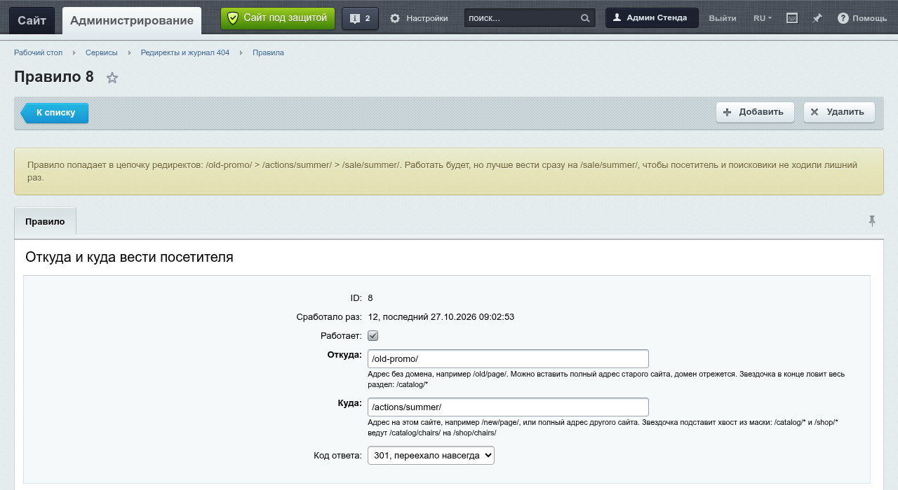
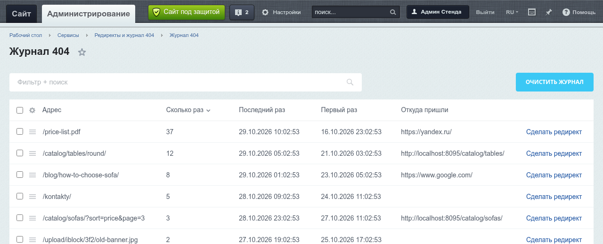
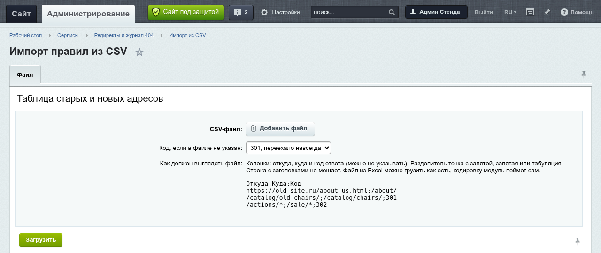

# Редиректы и журнал 404 для 1С-Битрикс

Модуль для переезда сайта и для порядка после него. Старые адреса уводятся на новые с кодом 301 или 302. Страницы, которых нет, копятся в журнал, и редирект из журнала делается одной кнопкой.

Что есть:
- правила редиректов: точный адрес, адрес с параметрами (`/page.php?id=5`) и маска на весь раздел (`/catalog/*`)
- метки utm и другие параметры переезжают на новый адрес
- петли (A на B, B на A) не сохраняются, а про цепочки (A на B, B на C) модуль предупреждает
- журнал 404: адрес, сколько раз открывали, когда и откуда пришли, и кнопка "Сделать редирект"
- импорт правил из CSV, можно прямо из Excel
- у каждого правила счетчик срабатываний, видно, какие правила еще нужны



## Установка

Нужно: Битрикс с главным модулем 23.0 или новее, PHP 8.1+, MySQL или MariaDB. Других модулей не надо, работает и на редакции "Старт".

1. Положить модуль в `local/modules/roman140176.redirects`. Папка должна называться именно так, это ID модуля.

   ```bash
   cd /var/www/site
   git clone https://github.com/roman140176/bitrix-redirects.git local/modules/roman140176.redirects
   ```

   Можно и без git: на гитхабе Code > Download ZIP, распаковать и переименовать папку `bitrix-redirects-main` в `roman140176.redirects`.

2. В админке: Marketplace > Установленные решения, у "Редиректы и журнал 404" нажать "Установить".

3. Готово, в админке появится Сервисы > Редиректы и журнал 404.

### Через composer

В composer.json сайта:

```json
{
    "repositories": [
        {"type": "vcs", "url": "https://github.com/roman140176/bitrix-redirects"}
    ],
    "require": {
        "roman140176/redirects": "dev-main"
    },
    "extra": {
        "bitrix-dir": "local"
    },
    "config": {
        "allow-plugins": {
            "composer/installers": true
        }
    }
}
```

Потом `composer update roman140176/redirects`, и модуль ляжет в `local/modules/roman140176.redirects` (это делает composer/installers). Если composer.json лежит в самой папке local, то `"bitrix-dir": "."`. Дальше ставить как в пункте 2.

## Как писать правила

| Откуда | Куда | Что будет |
|---|---|---|
| `/about-us.html` | `/about/` | `/about-us.html` и `/ABOUT-US.HTML` ведут на `/about/` |
| `/shop/index.php?id=15` | `/catalog/sofas/` | ловит и `/shop/index.php?utm_source=ya&id=15`, метка уедет на новый адрес |
| `/catalog/old/*` | `/catalog/new/*` | `/catalog/old/chairs/red/` ведет на `/catalog/new/chairs/red/` |
| `/news/*` | `/press/` | весь раздел на одну страницу |
| `/*` | `https://new-site.ru/*` | весь сайт на новый домен |

Подробнее:
- Регистр и слеш в конце не важны: `/old`, `/old/` и `/OLD/` это один адрес.
- Кириллица работает. Правило `/Старый-раздел/` поймает адрес и в обычном виде, и в %-кодировке, как его шлет браузер.
- Параметры. Если в правиле их нет, все параметры запроса переезжают на новый адрес как есть. Если есть, то они должны быть в запросе (порядок не важен), а остальные переезжают.
- Если подходит несколько правил, сначала берется правило с параметрами, потом точное, потом маска. Из масок побеждает та, что длиннее.
- 301 значит переехало навсегда, поисковики перенесут на новый адрес все, что накопил старый. 302 значит временно, например на время акции.
- В поле "Откуда" можно вставить полный адрес старого сайта, домен отрежется сам.

Петлю модуль не даст сохранить: если уже есть `/a/` на `/b/`, правило `/b/` на `/a/` вернется с ошибкой, в которой видно весь круг. Цепочку сохранить можно, она работает, но посетитель и поисковик лишний раз ходят по редиректам. Поэтому в форме правила появится подсказка, куда лучше вести сразу.



## Журнал 404

Модуль записывает каждый адрес, на котором сайт ответил 404. Один адрес это одна строка: сколько раз открывали, первый и последний раз, откуда пришли в последний раз. Сверху те, что открывают чаще всего, с них и стоит начинать.

"Сделать редирект" открывает форму правила уже с этим адресом. Как только появляется правило (через форму, импорт или включение в списке), адреса, на которые оно теперь срабатывает, уходят из журнала сами.



Чтобы журнал не забили боты, которые перебирают `/wp-admin` и `.env`:
- есть список масок, которые не пишем. По умолчанию там адреса WordPress, `.env`, `.git`, phpMyAdmin, `*.sql` и `*.bak`
- есть лимит строк, по умолчанию 10000. Когда журнал полон, новые адреса не пишутся, а у тех, что уже есть, счетчик продолжает расти
- агент раз в сутки удаляет адреса, которые не открывали 30 дней

Все это меняется в настройках модуля.

## Импорт из CSV

Сервисы > Редиректы и журнал 404 > Импорт из CSV. Колонки: откуда, куда и код ответа. Код можно не указывать, тогда возьмется тот, что выбран в форме.

```
Откуда;Куда;Код
https://old-site.ru/about-us.html;/about/
/catalog/old-chairs/;/catalog/chairs/;301
/actions/*;/sale/*;302
```

Разделитель точка с запятой, запятая или табуляция, модуль поймет сам. Строка с заголовками не мешает. Файл, сохраненный из Excel, можно грузить как есть, кодировку Windows-1251 модуль тоже поймет. Файл до 2 МБ, это десятки тысяч строк.

Каждая строка проверяется так же, как в форме: дубли и петли пропускаются. После загрузки видно, сколько правил добавилось, какие строки пропущены и почему, и какие правила попали в цепочки.



## Настройки и права

Настройки > Настройки продукта > Настройки модулей > Редиректы и журнал 404. Там журнал (включен или нет, лимит, сколько дней хранить, какие адреса не писать) и вкладка "Доступ".

Права: с "чтением" видно правила, журнал и формы, с "записью" можно менять. Администраторам можно все. Контент-менеджеру кроме права на модуль нужен вход в админку, то есть доступ его группы к папке /bitrix/admin. На обычной установке такой доступ есть у группы "Контент-редакторы".

## Чего модуль не делает

- Регулярных выражений нет. Маски со звездочкой хватает почти всегда, а ошибку в регулярке легко не заметить.
- Адреса `/bitrix/...` и админку не трогает, даже если правило подходит. Так маска `/*` не закроет вход в админку.
- POST не редиректит. После 301 браузер повторит запрос как GET, и данные формы пропадут.
- В `.htaccess` и конфиг nginx ничего не пишет, все работает внутри Битрикса. Поэтому редирект срабатывает, только если запрос дошел до PHP. При обычной настройке Битрикса адреса, которых нет на диске, доходят до PHP, так что старые `.html` и `.pdf` ловятся. А файл, который реально лежит на диске, веб-сервер отдаст сам, мимо модуля.
- Работает только с MySQL и MariaDB.

## Как устроено

- `lib/rule/` это классы без Битрикса: разбор адресов (`Url`), поиск правила (`Matcher`), петли и цепочки (`ChainChecker`). На них тесты.
- Редирект делает обработчик события `OnPageStart`, это самое начало хита. Правила сайта лежат в managed cache уже в виде готового индекса: точные адреса по ключу, маски по длине. Так что на хите одно чтение кеша и поиск по ключу, в базу модуль не ходит. Кеш сбрасывается при любом изменении правил.
- Счетчик срабатываний пишется прямым UPDATE мимо ORM, иначе события ORM сбрасывали бы кеш на каждом редиректе.
- Журнал пишет обработчик `OnEpilog`. 404 ставят по-разному, поэтому модуль смотрит и на `ERROR_404`, и на статус в `CHTTP`, и на статус ответа D7. Так ловятся и `404.php`, и компоненты.
- В журнале сначала пробуем прибавить счетчик у уже известного адреса. Лимит и INSERT проверяются только для нового адреса, так частые 404 стоят один запрос.
- Петли проверяются в событиях ORM (`onBeforeAdd`, `onBeforeUpdate`), поэтому их не сохранит ни форма, ни импорт, ни свой код через `RuleTable::add`.
- Если в модуле что-то сломается, сайт продолжит работать: обработчики ловят исключения и просто ничего не делают.

## Тесты

```bash
composer install
vendor/bin/phpunit
```

Тесты на классы без Битрикса, они же гоняются на GitHub на PHP 8.1, 8.2 и 8.3. То, что без Битрикса не проверить (установку и удаление, админку, редиректы и журнал по HTTP), я гонял на стенде с редакцией "Старт".

## Лицензия

MIT
